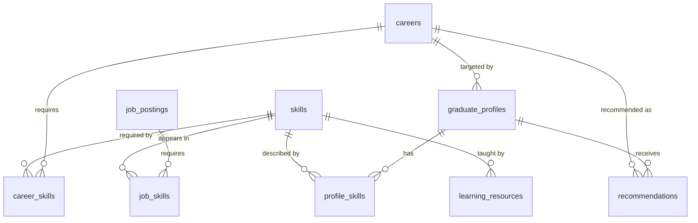

# Initial Data Model

Logical model for the MVP. Physical PostgreSQL DDL (raw, staging, curated and analytics schemas, constraints, indexes) is implemented in Phase 3 (`database/schema.sql`). Types below are logical targets and may be refined then.

## Entities

### graduate_profiles
| Field | Type | Notes |
|---|---|---|
| profile_id | text, PK | |
| education_level | text | |
| field_of_study | text | |
| experience_years | numeric | `>= 0` |
| target_career | text, FK -> careers.career_id, nullable | |

### skills
| Field | Type | Notes |
|---|---|---|
| skill_id | text, PK | `SK01`..`SK70` |
| skill_name | text, unique | canonical snake_case name |
| category | text | |
| aliases | text[] / text | alternative spellings |

### profile_skills
| Field | Type | Notes |
|---|---|---|
| profile_id | text, FK -> graduate_profiles | PK part |
| skill_id | text, FK -> skills | PK part |
| proficiency | text / smallint | scale to be fixed in Phase 5/6 |

### job_postings
| Field | Type | Notes |
|---|---|---|
| job_id | text, PK | |
| title | text | not empty |
| company | text | |
| location | text | |
| description | text | |
| experience_required | text | |
| education_required | text | |
| source | text | provenance |
| date_posted | timestamp | |

### job_skills
| Field | Type | Notes |
|---|---|---|
| job_id | text, FK -> job_postings | PK part |
| skill_id | text, FK -> skills | PK part |
| importance | numeric | |

### careers
| Field | Type | Notes |
|---|---|---|
| career_id | text, PK | `CA01`..`CA09` |
| career_name | text, unique | |
| description | text | |

### career_skills
| Field | Type | Notes |
|---|---|---|
| career_id | text, FK -> careers | PK part |
| skill_id | text, FK -> skills | PK part |
| importance | numeric | `0..1` weight |
| frequency | numeric | observed share of postings |

### learning_resources
| Field | Type | Notes |
|---|---|---|
| resource_id | text, PK | |
| title | text | |
| provider | text | |
| url | text | |
| skill_id | text, FK -> skills | |
| difficulty | text | |
| format | text | |
| cost | text / numeric | |

### recommendations
| Field | Type | Notes |
|---|---|---|
| recommendation_id | text, PK | |
| profile_id | text, FK -> graduate_profiles | |
| career_id | text, FK -> careers | |
| score | numeric | compatibility score, not an employment probability |
| model_version | text | |
| created_at | timestamp | |

## Relationships

## Design principles
- Raw data is kept separate from transformed data; provenance (source, source job id, retrieval time, content hash) is retained downstream (Phase 2/3).
- The skill and career taxonomies are the source of truth for identity; the NLP layer links to them and never invents skills.
- Every recommendation stores a `model_version` so results are traceable to the method that produced them.
